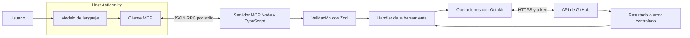

# GitHub MCP Server

Proyecto Integrador del Módulo 5 de Backend, desarrollado por Aldana Carmuega.

Servidor MCP en Node.js y TypeScript que expone cinco herramientas para consultar repositorios, listar y crear issues, crear repositorios y guardar un archivo mediante un commit. Utiliza el SDK oficial de MCP, Octokit y Zod. Un host compatible puede ofrecer estas herramientas a un modelo para resolver pedidos en lenguaje natural.

## Casos de uso

- Consultar los repositorios propios y sus enlaces sin navegar por la interfaz de GitHub.
- Registrar un error o una tarea mediante un issue con título y descripción.
- Crear un repositorio de práctica y guardar un archivo de texto en una rama existente.
- Consultar issues abiertos y devolver información resumida a un cliente MCP.

## Requisitos del sistema

- Node.js 24 o superior, según `package.json`.
- npm y Git instalados.
- Una cuenta de GitHub y un Personal Access Token con acceso a los recursos de prueba.
- Acceso a internet para instalar dependencias y utilizar GitHub.
- MCP Inspector para pruebas manuales, o un host MCP compatible. La consigna utiliza Antigravity.

## Instalación paso a paso

Descargá el repositorio o clonalo usando la URL pública que figure en GitHub. El marcador del siguiente comando debe reemplazarse por esa URL real:

```bash
git clone <URL_DEL_REPOSITORIO>
```

Abrí una terminal dentro de la carpeta descargada o clonada y ejecutá:

```bash
npm install
cp .env.example .env
```

Para reproducir exactamente las versiones del lockfile en una instalación limpia, también podés usar `npm ci`.

Editá `.env` localmente:

```dotenv
GITHUB_TOKEN=TU_TOKEN_REAL
```

El texto `TU_TOKEN_REAL` es un marcador. No es una credencial utilizable. No compartas el archivo ni publiques su contenido.

Después ejecutá:

```bash
npm run typecheck
npm run build
npm test
```

### Scripts

| Comando | Función |
|---|---|
| `npm run dev` | Ejecuta el entry point TypeScript con tsx |
| `npm run build` | Compila el código de `src` a `dist` |
| `npm start` | Ejecuta `dist/server.js` |
| `npm test` | Ejecuta Vitest una vez |
| `npm run typecheck` | Comprueba tipos del código y de los tests sin generar JavaScript |

`npm start` queda esperando mensajes por stdin. No abre una página ni un puerto HTTP. Para detenerlo, presioná Control + C. Un host MCP inicia su propia instancia del proceso, por lo que no necesitás dejar `npm start` ejecutándose aparte.

## Configuración

### Obtener un GitHub Personal Access Token

1. Iniciá sesión en GitHub.
2. Abrí Settings, Developer settings, Personal access tokens, Tokens (classic).
3. Elegí Generate new token (classic).
4. Escribí una descripción identificable y una fecha de vencimiento limitada.
5. Seleccioná los scopes indicados en la siguiente tabla y generá el token.
6. Copialo a tu configuración privada. GitHub solo muestra su valor completo al crearlo.

### Scopes del token

La consigna indica los siguientes scopes de un token classic:

| Scope | Alcance |
|---|---|
| `repo` | Operaciones sobre repositorios e issues, incluidos repositorios privados |
| `user` | Operaciones relacionadas con el perfil del usuario |
| `admin:org` | Operaciones administrativas de organizaciones |

El token no puede otorgar permisos que su propietario no tenga. Las cinco herramientas actuales crean repositorios personales y trabajan con repositorios e issues; no implementan administración de organizaciones.

Más información: [documentación oficial de GitHub sobre tokens](https://docs.github.com/en/authentication/keeping-your-account-and-data-secure/managing-your-personal-access-tokens).

### Configurar .env

Creá el archivo local a partir de la plantilla, si todavía no lo hiciste:

```bash
cp .env.example .env
```

Editá su contenido:

```dotenv
GITHUB_TOKEN=TU_TOKEN_REAL
```

Reemplazá el marcador por tu token. `.env` está excluido de Git y `.env.example` no contiene credenciales reales. No publiques el token en código, documentación ni capturas.

El servidor lee `process.env.GITHUB_TOKEN`. dotenv carga el `.env` de la raíz del proyecto aunque el host inicie el proceso desde otra carpeta. Una variable definida en el entorno tiene prioridad sobre el archivo.

### Configurar el MCP server en Antigravity

1. Compilá con `npm run build`.
2. Localizá Node con `command -v node` en macOS/Linux o `where node` en Windows.
3. En el panel del agente, abrí MCP Servers, Manage MCP Servers y View raw config.
4. Agregá la entrada dentro de `mcpServers` sin borrar otros servidores.

Ejemplo portable, con marcadores que debés reemplazar:

```json
{
  "mcpServers": {
    "github-m5": {
      "command": "/RUTA/ABSOLUTA/A/node",
      "args": ["/RUTA/ABSOLUTA/AL/PROYECTO/dist/server.js"]
    }
  }
}
```

El servidor carga su `.env` local, por lo que no necesita el token en este JSON.

En la configuración usada durante el desarrollo, Node estaba en `/usr/local/bin/node` y el proyecto en `/Users/aldanacarmuega/Programacion/ProyectoM5-AldanaCarmuega`. Otras computadoras deben usar sus propias rutas.

Guardá y refrescá la configuración. Verificá que aparezcan cinco herramientas habilitadas. Después abrí un chat nuevo y probá un prompt de consulta. Reconocer herramientas y ejecutarlas desde el modelo son dos comprobaciones distintas.

La ruta global y la interfaz pueden variar con la versión. Consultá la [documentación oficial de MCP en Antigravity](https://antigravity.google/docs/mcp).

## Herramientas

Los siguientes argumentos JSON sirven para Inspector. Los prompts son ejemplos para un host con agente operativo; no se presentan como ejecuciones ya verificadas en Antigravity.

### list_repositories

Lista repositorios propios del usuario autenticado, ordenados por actualización descendente. No incluye automáticamente todos los repositorios de organizaciones o aquellos en los que solo colabora.

| Parámetro | Tipo | Obligatorio | Predeterminado |
|---|---|---|---|
| `page` | Entero, mínimo 1 | No | 1 |
| `perPage` | Entero, entre 1 y 100 | No | 30 |

```json
{ "page": 1, "perPage": 5 }
```

Prompt: «Usá list_repositories del servidor github-m5 para listar mis primeros cinco repositorios con sus enlaces».

Devuelve `page`, `perPage` y `repositories`. Cada repositorio incluye `name`, `fullName`, `description`, `url` y `private`.

### list_issues

Lista los issues abiertos de un repositorio. Excluye pull requests después de obtener una página de GitHub. Por eso puede devolver menos issues que `perPage`; una página vacía no demuestra que todo el repositorio carezca de issues.

| Parámetro | Tipo | Obligatorio | Predeterminado |
|---|---|---|---|
| `owner` | Texto, usuario u organización | Sí | — |
| `repo` | Texto, nombre de repositorio | Sí | — |
| `page` | Entero, mínimo 1 | No | 1 |
| `perPage` | Entero, entre 1 y 100 | No | 30 |

```json
{
  "owner": "carmuegaaldana",
  "repo": "mcp-pruebas-aldana",
  "page": 1,
  "perPage": 10
}
```

Prompt: «Listá los issues abiertos de carmuegaaldana/mcp-pruebas-aldana usando list_issues».

Devuelve el contexto de paginación y `issues`, con `number`, `title`, `body`, `url` y `author` cuando existe.

### create_repository

Crea un repositorio en la cuenta personal del token y lo inicializa con README. No recibe una organización como destino y no crea el proyecto local en tu computadora.

| Parámetro | Tipo | Obligatorio | Predeterminado |
|---|---|---|---|
| `name` | Texto, 3 a 100 caracteres | Sí | — |
| `description` | Texto no vacío | Sí | — |
| `isPrivate` | Booleano | No | true |

```json
{
  "name": "mcp-demo-entrega-01",
  "description": "Repositorio de demostración del proyecto M5",
  "isPrivate": true
}
```

Prompt: «Creá con create_repository un repositorio privado llamado mcp-demo-entrega-01, con descripción Repositorio de demostración del proyecto M5».

Devuelve `name`, `fullName`, `url`, `private` y `defaultBranch`. Elegí un nombre nuevo para cada demostración. Ejecutar la herramienta produce un recurso real en GitHub.

### create_issue

Crea un issue con título y descripción en un repositorio accesible para el token.

| Parámetro | Tipo | Obligatorio |
|---|---|---|
| `owner` | Texto | Sí |
| `repo` | Texto | Sí |
| `title` | Texto no vacío | Sí |
| `body` | Texto no vacío, admite Markdown | Sí |

```json
{
  "owner": "carmuegaaldana",
  "repo": "mcp-pruebas-aldana",
  "title": "Prueba de entrega M5",
  "body": "Issue creado mediante la herramienta MCP."
}
```

Prompt: «Creá un issue en carmuegaaldana/mcp-pruebas-aldana con título Prueba de entrega M5 y descripción Issue creado mediante la herramienta MCP».

Devuelve `number`, `title`, `body` y `url`. Cada ejecución exitosa crea un issue nuevo.

### create_commit

Crea o reemplaza un archivo de texto en una rama existente y genera un commit. El contenido es el texto completo que debe quedar en el archivo. No aplica un diff ni lee un archivo de tu computadora.

| Parámetro | Tipo | Obligatorio |
|---|---|---|
| `owner` | Texto | Sí |
| `repo` | Texto | Sí |
| `branch` | Texto, rama existente | Sí |
| `path` | Texto, ruta relativa dentro del repositorio | Sí |
| `content` | Texto completo, puede estar vacío | Sí |
| `message` | Texto no vacío | Sí |

```json
{
  "owner": "carmuegaaldana",
  "repo": "mcp-pruebas-aldana",
  "branch": "main",
  "path": "demo-entrega.txt",
  "content": "Archivo de demostración del módulo 5.\n",
  "message": "Agregar archivo de demostración"
}
```

Prompt: «Usá create_commit para guardar demo-entrega.txt en main de carmuegaaldana/mcp-pruebas-aldana, con contenido Archivo de demostración del módulo 5 y mensaje Agregar archivo de demostración».

Para probar una actualización, conservá la ruta y cambiá `content` y `message`. La función obtiene automáticamente el SHA del archivo existente y convierte el contenido UTF-8 a Base64.

Devuelve `path`, `branch`, `action` (`created` o `updated`), `commitSha`, `commitUrl` y `fileUrl` cuando está disponible. La rama debe existir. Las ramas protegidas o los cambios en workflows pueden requerir permisos o flujos adicionales que esta implementación no evita.

## Arquitectura



El modelo participa en la elección de la herramienta. El cliente MCP es el componente del host que gestiona la comunicación con el servidor; el modelo y el cliente no son el mismo componente. El servidor recibe argumentos estructurados, los valida y ejecuta la operación. MCP Inspector permite invocar esas herramientas directamente durante el desarrollo.

## Cómo ejecutar los tests

```bash
npm test
```

| Archivo | Comportamiento cubierto |
|---|---|
| `schemas.test.ts` | Entradas válidas e inválidas, defaults, paginación, rutas y contenido |
| `errors.test.ts` | Clases, mensajes públicos, estados HTTP y causas de red |
| `github.test.ts` | Las cinco operaciones con el cliente de Octokit simulado |
| `retry.test.ts` | Máximo de intentos y tiempos con reloj simulado |
| `logging.test.ts` | Canal stderr y exclusión del mensaje interno |
| `server.test.ts` | Cliente y servidor MCP en memoria, registro y validación |

Los tests no crean recursos reales ni necesitan un token. El cliente o las operaciones se reemplazan mediante mocks. Un test passing no demuestra disponibilidad del host externo, del modelo ni de GitHub en ese momento.

### Pruebas manuales con MCP Inspector

Primero compilá:

```bash
npm run build
npx @modelcontextprotocol/inspector node dist/server.js
```

Si npm solicita instalar Inspector, revisá el paquete indicado y aceptá su instalación. Abrí la dirección local que muestra el comando, conectá por STDIO, listá las herramientas y ejecutá los ejemplos JSON de este README.

Inspector inicia el servidor. Para probar valores fuera de rango, usá la edición JSON: el formulario visual puede ajustar un número al rango permitido antes de enviarlo.

## Troubleshooting

| Problema | Qué revisar |
|---|---|
| `npm start` parece quedarse esperando | Es normal con stdio. Conectá un cliente MCP, no esperes una página web |
| Archivo compilado ausente o cambios viejos | Ejecutá `npm run build` y reiniciá la instancia de Inspector o del host |
| `Missing script` | Revisá nombre del comando y sintaxis de `package.json` |
| Token ausente | Guardá `.env` en la raíz del proyecto o definí `GITHUB_TOKEN` en el entorno |
| 401 | Verificá vigencia y valor del token, sin imprimirlo |
| 403 | Revisá permisos, política de organización, SSO y señales de rate limiting |
| 404 | Copiá `owner` y `repo` de `fullName`; un repositorio privado sin acceso también puede responder 404 |
| 422 al crear un repositorio | Verificá si el nombre ya está en uso y que los datos cumplan restricciones |
| Issues vacíos | Revisá página y repositorio; los pull requests se excluyen después de paginar |
| Archivo nuevo en lugar de actualización | Revisá que `path` sea exactamente la misma ruta |
| Inspector ajusta 101 a 100 | Enviá los argumentos desde el editor JSON para probar el rechazo del servidor |
| MCP no aparece en la tienda de Antigravity | Es un servidor local personalizado. Buscalo en Manage MCP Servers |
| Agente falla incluso con MCP desactivado | Separá el diagnóstico del host del servidor. Revisá los logs de Antigravity y el estado del modelo |

Las lecturas admiten hasta tres intentos, con esperas progresivas y respeto de los plazos de GitHub. Si la espera exigida supera cinco segundos, se devuelve el error sin reintentar antes de tiempo. Las escrituras no se repiten automáticamente para evitar duplicados. El timeout por solicitud es de diez segundos.

Los logs van por stderr y stdout queda reservado para el protocolo MCP. No se publican el token ni errores técnicos completos.

Durante la integración, Antigravity reconoció cinco herramientas, pero la ejecución desde su modelo quedó pendiente por fallos que también ocurrían con el MCP desactivado.

## Licencia

MIT, la licencia sugerida en la consigna.

```text
MIT License

Copyright (c) 2026 Aldana Carmuega

Permission is hereby granted, free of charge, to any person obtaining a copy
of this software and associated documentation files (the "Software"), to deal
in the Software without restriction, including without limitation the rights
to use, copy, modify, merge, publish, distribute, sublicense, and/or sell
copies of the Software, and to permit persons to whom the Software is
furnished to do so, subject to the following conditions:

The above copyright notice and this permission notice shall be included in all
copies or substantial portions of the Software.

THE SOFTWARE IS PROVIDED "AS IS", WITHOUT WARRANTY OF ANY KIND, EXPRESS OR
IMPLIED, INCLUDING BUT NOT LIMITED TO THE WARRANTIES OF MERCHANTABILITY,
FITNESS FOR A PARTICULAR PURPOSE AND NONINFRINGEMENT. IN NO EVENT SHALL THE
AUTHORS OR COPYRIGHT HOLDERS BE LIABLE FOR ANY CLAIM, DAMAGES OR OTHER
LIABILITY, WHETHER IN AN ACTION OF CONTRACT, TORT OR OTHERWISE, ARISING FROM,
OUT OF OR IN CONNECTION WITH THE SOFTWARE OR THE USE OR OTHER DEALINGS IN THE
SOFTWARE.
```
